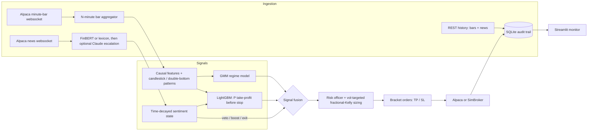

# Sentinel Trader

An intraday trading bot for US equities on [Alpaca](https://alpaca.markets). It combines a LightGBM probability model, chart-pattern features, a market-regime filter and real-time news sentiment, with an independent risk officer that can veto any trade or shut the bot down.

It runs in **paper trading by default**. Real money takes three separate switches (see [Safety](#safety)).

It also ships a **Streamlit app** (`streamlit_app.py`) for analysis and simulation:

- **Analyze any asset:** search any stock, ETF, crypto or commodity (e.g. `AAPL`, `BTC-USD`, `GC=F`, `RELIANCE.NS`). The app downloads up to 10 years of daily data and computes 49 factors: trend, momentum, mean reversion, volatility, **demand & volume** (OBV, accumulation/distribution, money flow), **psychology** (fear & greed composite, VIX, 52-week anchoring, drawdown, streaks), **macro** (market trend, rates, dollar, beta) and seasonality. It then runs 9 rule strategies, a walk-forward ML ensemble and an adaptive meta-strategy out-of-sample, and returns an evidence-weighted signal with its accuracy attached.
- **Accuracy Lab:** the same out-of-sample test across a basket of assets.
- **Trading bot lab:** the bot's 15-minute strategy on the last ~60 days of real bars. It shows the walk-forward backtest and a forward simulation in which a model that never saw the last N sessions trades them bar by bar.
- **Paper account:** a read-only view of your Alpaca paper account (keys go in Streamlit secrets).

```bash
pip install -r requirements.txt && streamlit run streamlit_app.py
```

## Results on real data (Yahoo Finance, to 13 Nov 2026)

These are reported as measured, not tuned to look good.

| Test | Result |
|---|---|
| Intraday bot, walk-forward, 10 US large caps, 15-min bars, ~33 sessions OOS | Model AUC 0.60. 49 trades, profit factor 1.23, **+0.5%** vs equal-weight buy & hold −6.5%, max drawdown −0.65% |
| Label/feature variants (TP/SL/horizon, market-context features), split-half check | The default (TP 2 ATR / SL 1 ATR / 8 bars, no market features) was best in both halves. Entry threshold 0.42 was the only one profitable in both halves |
| Daily direction, 5-day horizon, 17 assets, ~6 years OOS | Mean AUC **0.505**: indistinguishable from a coin flip. 3 of 17 assets p<0.05 (about what chance gives you) |
| Pooled cross-asset model, 5- and 21-day horizons | No improvement (AUC 0.47–0.50) |
| Rule strategies vs buy & hold (daily) | Trend and volatility filters mostly **cut drawdowns** (e.g. NVDA −66% → −12%). They rarely beat buy & hold on Sharpe |

Takeaway: the intraday bot shows a small edge that is not yet statistically proven. Daily direction prediction does not. The app weights each signal by its proven edge, so models with no edge get no vote.

```
sentinel fetch     ->  sentinel train  ->  sentinel backtest  ->  sentinel replay  ->  sentinel live
 (bars + news)        (walk-forward)       (out-of-sample)       (live code path)     (Alpaca paper)
```

## Architecture



The same `TradingEngine` drives backtests, replays and live trading. Only three things change between modes: where the data comes from, which signal provider is used, and which broker fills the orders. That means the decision logic, sizing and risk rules you backtest are exactly the code that trades.

| Layer | Module | What it does |
|---|---|---|
| Data | `data/alpaca_data.py`, `data/store.py` | Adjusted N-minute bars and news from Alpaca REST; SQLite (WAL) for market data and every decision, order, fill and risk event |
| Live ingestion | `live/runner.py`, `live/aggregator.py` | Websocket streams in threads → one asyncio queue; 1-min bars rolled into N-min bars aligned to the 9:30 open |
| Features | `features/technical.py`, `features/patterns.py` | 31 scale-free features: returns, volatility, ATR, RSI, MACD, Bollinger position, volume z-score, gap, engulfing/hammer/doji, 20-bar breakouts, causal double bottom/top |
| Labels | `features/labels.py` | Triple-barrier labels matching the real bracket orders (TP 2 ATR, SL 1 ATR, max 8 bars, never across the close) |
| Model | `models/gbm.py` | LightGBM with purged + embargoed expanding walk-forward validation; production model refit on all data |
| Regime | `models/regime.py` | Gaussian mixture on volatility/trend; highest-volatility state switches entries off |
| News | `models/sentiment.py` | FinBERT (if installed) or a finance lexicon; ambiguous high-impact headlines optionally escalated to Claude; per-symbol exponentially decayed score |
| Fusion | `strategy/ensemble.py` | Probability threshold + expected-value check + regime gate + news veto / boost / exit |
| Risk | `risk/officer.py`, `risk/sizing.py` | Daily drawdown halt, kill switch, latency and stale-data guards, exposure caps, session windows; volatility-targeted, quarter-Kelly-capped sizing |
| Execution | `execution/broker.py` | Alpaca bracket orders with idempotent client order IDs; a simulator with slippage, commissions, gap fills and stop-first ambiguity handling |
| Backtest | `backtest/engine.py`, `backtest/metrics.py` | Event-driven replay through the real engine; Sharpe, Sortino, drawdown, profit factor, equal-weight buy-and-hold benchmark |

## Quick start

```bash
python -m venv .venv && source .venv/bin/activate
pip install -e ".[dev,dashboard]"          # add ,nlp for FinBERT and ,llm for Claude escalation
```

### 1. Try the full pipeline offline (no API keys)

```bash
sentinel fetch --synthetic --days 300      # synthetic prices + headlines
sentinel train --holdout-days 10           # walk-forward report + production model
sentinel backtest                          # out-of-sample backtest -> reports/backtest_*/
sentinel replay --days 10                  # live code path on the held-out days
streamlit run dashboard/app.py -- --db data/replay.db
```

Synthetic results tell you the plumbing works. They say nothing about real markets.

### 2. Real data and paper trading

1. Create a free Alpaca account, switch to **Paper Trading**, and generate API keys.
2. `cp .env.example .env`, then fill in `ALPACA_API_KEY` and `ALPACA_SECRET_KEY`.
3. Pick your symbols and timeframe in `config/config.yaml`.

```bash
sentinel fetch                             # ~2 years of 15-min bars + news (takes a few minutes)
sentinel train --holdout-days 20
sentinel backtest
sentinel replay --days 20                  # does the live path agree with the backtest?
sentinel train                             # refit on everything before going live
sentinel live                              # paper trading; Ctrl+C to stop
streamlit run dashboard/app.py             # in a second terminal
```

Or run the bot and the dashboard together with `docker compose up -d` (dashboard on http://localhost:8501).

**Retraining:** markets drift, so schedule a weekly refit outside market hours, e.g. cron `0 2 * * 6 cd /path && sentinel fetch && sentinel train`, then restart the bot.

### Other commands

```bash
sentinel status                            # account, positions, market clock, recent risk events
sentinel flatten                           # cancel orders + close positions in the configured symbols
touch KILL                                 # kill switch: bot flattens and exits at its next tick
```

## How a trade happens

1. A 15-minute bar completes. Features are computed on a rolling 300-bar window. A test checks that they match the training features exactly.
2. The model outputs *P(take-profit is hit before the stop)*. An entry needs `prob ≥ entry_threshold` and a positive expected value in R units: `p·(TP/SL) − (1−p) ≥ min_edge`.
3. The regime filter blocks entries in the most volatile state. A decayed news score ≤ −0.5 vetoes longs; ≥ +0.5 scales the size up by 1.25×.
4. Sizing: `risk$ = equity × min(0.5%, ¼·Kelly)`, `shares = risk$ / (1 ATR stop)`, capped at 20% notional and the remaining gross-exposure headroom.
5. The risk officer checks halts, latency, session timing, open positions and exposure. Then a **bracket order** (market entry + TP limit + SL stop) is sent with the client ID `snt-<SYMBOL>-<bar time>`, so a reconnect can never double-enter.
6. Exits: TP, SL, a strongly negative headline (checked on arrival in live mode), the 15:50 flatten, or a drawdown or kill-switch halt.

## Validation choices

These are deliberate departures from a "throw every model at it" design:

- **Purged, embargoed walk-forward.** Any training row whose label window could overlap the test fold is dropped, plus an 8-bar embargo. The backtest only trades on predictions from models that never saw that period. (Full combinatorial purged CV is a natural next step. Walk-forward is the closer match to how the bot is actually retrained.)
- **A Gaussian mixture, not an HMM, for regimes.** HMM state decoding (Viterbi or smoothing) uses the whole sequence, which quietly leaks future volatility into a backtest. A GMM classifies each bar from its own features.
- **Labels that mirror the orders.** The model is trained on exactly the event the bracket order pays out on, with the same ATR distances and the same session cut-off. A bar that touches both barriers counts as a loss, and the simulator makes the same assumption.
- **One engine for every mode.** The backtester replays events through the production `TradingEngine` rather than a separate vectorized framework, so no logic is reimplemented.
- **A train/serve parity test.** `test_train_serve_parity` feeds bars one at a time through the live signal path and asserts the probabilities equal the batch pipeline's to 1e-6.
- **Benchmarked.** Every report includes equal-weight buy-and-hold of the same symbols over the same window.

Deep sequence models (TFT/LSTM) and 1D-CNN or DTW pattern matchers are left out on purpose. On a few years of 15-minute bars they usually overfit compared with gradient boosting on engineered features. The `ModelBundle` interface makes them easy to add and A/B against the baseline later.

## Safety

- **Paper by default.** Real money needs all three: `mode: live` in the config, `SENTINEL_LIVE_CONFIRM=yes` in the environment, *and* `sentinel live --confirm-live`. Missing any one, the bot refuses to start.
- **Use a dedicated account.** The bot only manages the symbols in its config, but daily drawdown is measured on total account equity.
- **Hard limits:** −2% daily drawdown flattens and halts until the next session. The `KILL` file flattens and stops. Slow broker calls or stale bars block entries. Everything is flattened before the close, so no overnight risk.
- **Day-trading rules:** FINRA's pattern-day-trader rule ($25k minimum) was eliminated effective June 4, 2026, but brokers have until October 2027 to migrate. If your account still enforces the old limit, set `risk.pdt_guard: true`.
- **Data feed:** the free IEX feed carries only part of US volume. Train and trade on the same feed (`data.feed`). Volume features from IEX are not comparable to consolidated SIP volume.
- Paper trade for at least 4–8 weeks and compare live fills against `sentinel replay` over the same days before risking capital. Backtests are optimistic: they cannot model queue position, partial fills, or market impact.

This is research and engineering software, not financial advice. Trading can lose more than you expect, and past or simulated performance does not predict future results.

## Tests

```bash
pytest -q          # 36 tests, ~3 s, no network
ruff check src tests dashboard
```

The suite covers: no-lookahead features, triple-barrier edge cases (stop-first, session cut-off), walk-forward purging, news only used after publication, sizing math, every risk rule, simulator fills (gaps, slippage, duplicate IDs), the bar aggregator, Alpaca request construction (with a fake client), a full backtest, a drawdown-halt scenario, train/serve parity, and **the live runner end to end with fake websocket streams**, from minute bars through aggregation, signals, bracket orders and the kill-switch shutdown.

## Project layout

```
config/config.yaml        all tunables (no secrets)
src/sentinel/
  cli.py  engine.py  pipeline.py  config.py  events.py  market_time.py
  data/  features/  models/  strategy/  risk/  execution/  backtest/  live/
dashboard/app.py          Streamlit monitor (read-only on the SQLite audit trail)
tests/                    pytest suite
```

## License

MIT
