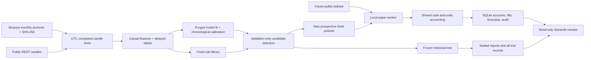

# Crypto research and forward paper system

The research package is independent of the existing stock bot. The initially missing stock modules were restored upstream and integrated before this addition. No live trading connection or authenticated exchange method exists in the crypto package. The primary experiment uses spot prices only and requires no credentials.

`features.py` contains all causal inputs and rule decisions. `models.py` owns training and calibration boundaries. `research.py` owns the fixed candidate library, temporal selection, final test and audit exports. `execution.py` accounts for cash, units, costs and observed-price circuit breakers for both historical and prospective simulations. `paper.py` supplies actual later quotes, stores all state in SQLite and skips stale/historical execution. `dashboard.py` reads the evidence without controlling execution.

Historical next-open execution is an approximation. The paper worker uses the first fresh quote it actually observes after the candle closes, rather than claiming a fill at the already-past open. Historical risk checks occur at opens/closes; forward paper checks occur on each observed quote, normally every minute. These differences are explicitly disclosed and must be studied against the future ledger.

The worker keeps three fixed-capital sleeves per independent candidate portfolio. It does not silently transfer gains between coins. Transactional state includes the last processed candle and each account. SQLite WAL allows the dashboard to read while the worker writes. An OS socket lease prevents duplicate workers, and transaction rollback prevents a process interruption from committing half a cycle's ledger. Public-data failures are logged and block affected simulated orders. Circuit breakers are not guaranteed price stops.

The current policies are intentionally fixed, which produces an interpretable prospective test. Future retraining should create an immutable model version, log the effective timestamp, preserve old forecasts and use the same published selection rule on information observable before that timestamp. Do not regenerate the first sealed test to improve its headline score.

Revisit this architecture when adding a second venue, exact tick replay, liquidity-aware sizing, a server host, point-in-time news or an equity restoration. A public web dashboard is a viewing surface; it does not host this computer's always-on worker.
